# BuildSuite Takeoff Studio

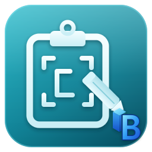

A Windows desktop program (with a web version for testing) for construction-drawing **measurement, markup and quantity
takeoff**, built for the way estimators work through a drawing set. Drop in a PDF drawing set, label the
sheets, calibrate scales, measure and count with standardized Tool Chest tools, and work with every quantity in an
editable, filterable markup database that stays linked to the drawing. Part of the **BuildSuite** family of programs.

> **Version 1.18.0**: **licensing** with two tiers – **Basic** and **Pro**. Pro adds the **Combine Report** and the
> **Automatic Takeoff**; enter a license key in *Help → License…* (1.17.0: Create Report – order list and cut list;
> 1.16.0: split the view as many times as you want) – see the [changelog](CHANGELOG.md).

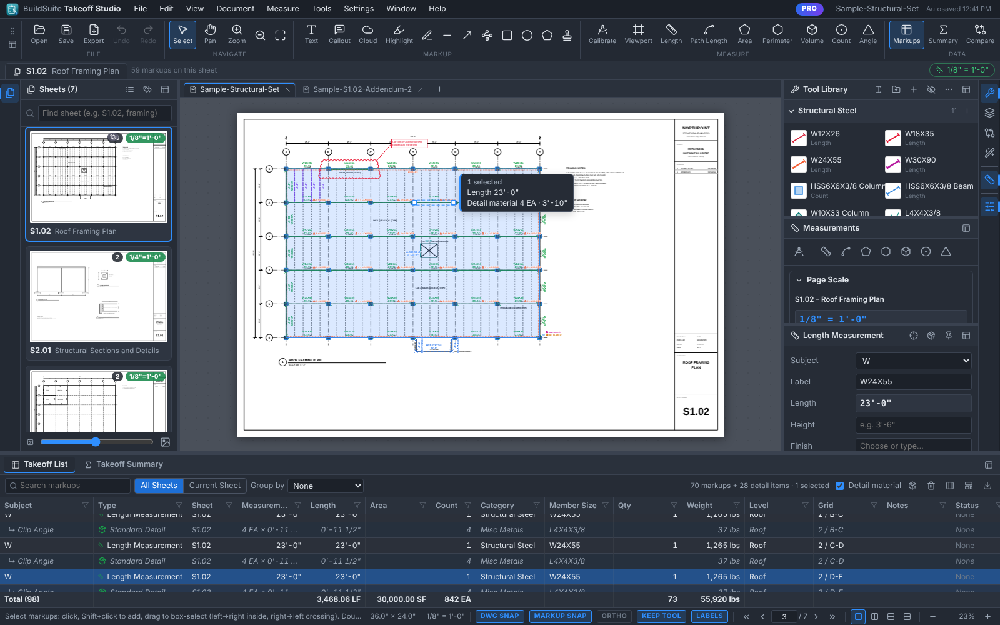

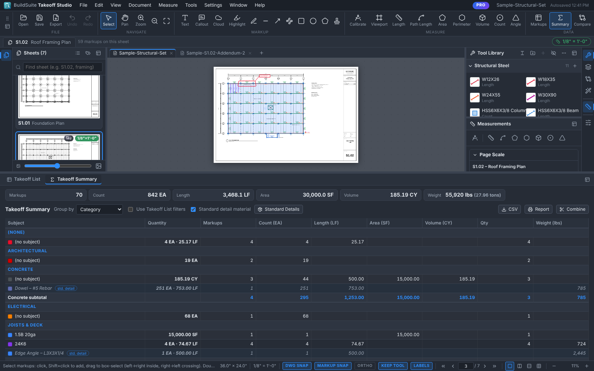

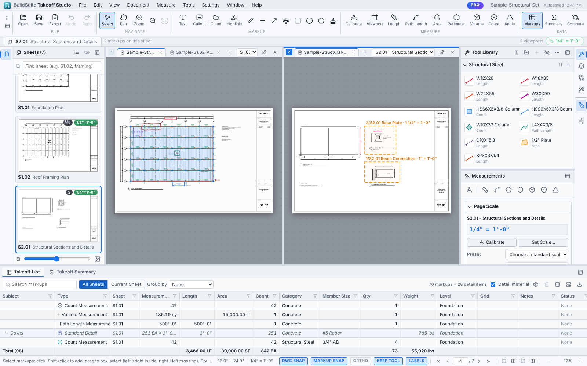

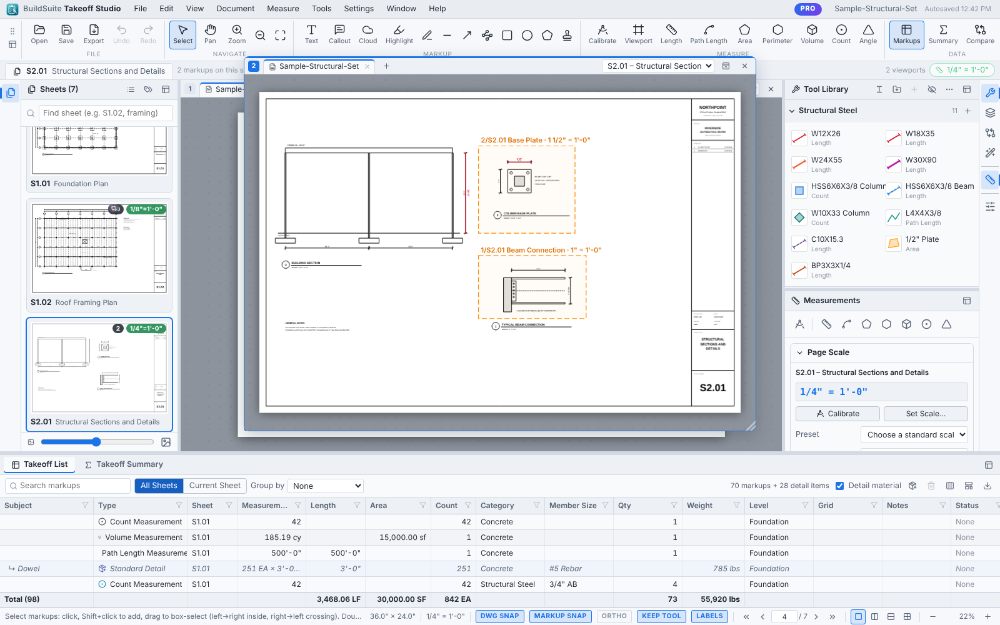

## Install on Windows

Download **BuildSuite-Takeoff-Studio-Setup-x.y.z.exe** from the latest
[Windows installer workflow run](https://github.com/jakmartin13101/pdf/actions/workflows/windows-installer.yml) (artifact
*BuildSuite-Takeoff-Studio-Setup*) or from a GitHub release, then run it:

1. **Welcome** → **License Agreement**: the BuildSuite Takeoff Studio Terms of Service must be accepted (*I Agree*).
2. Choose *Only for me* or *Anyone who uses this computer*, and the install folder.
3. Setup creates a **desktop shortcut** and a **Start menu → BuildSuite → BuildSuite Takeoff Studio** entry, and
   registers the program in *Settings → Apps* for uninstalling.

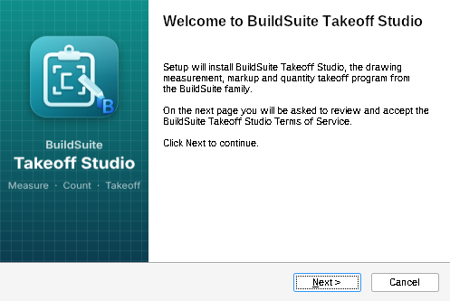 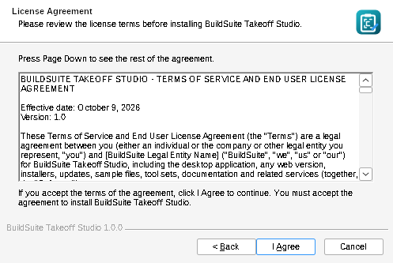

The installer is not code-signed yet, so Windows SmartScreen shows *Windows protected your PC* on first run
(*More info → Run anyway*). Sign it with your organisation's certificate before distributing (see
[Building the installer](#building-the-windows-installer)).

The desktop app works offline. PDFs can also be opened by dragging them onto the window or the desktop shortcut, or from
Explorer with *Open with → Choose another app* (pick BuildSuite Takeoff Studio once; the installer does not take over
the default PDF viewer). *Save* writes the takeoff back into the PDF it was opened from; *Save As* and exports use the
normal Windows *Save As* dialog.

## Quick start (web version for testing)

```bash
npm install
npm run dev          # http://localhost:5173  (add ?sample to auto-open the sample set)
npm run desktop      # build and run the desktop app (Electron) on this machine
```

On the start screen choose **Open Example Takeoff** (the sample set calibrated, with a structural takeoff already in
progress), **Open Sample Drawing Set** (the same 7-sheet warehouse set — foundation and framing plans, details at mixed
scales, architectural and MEP sheets — with no takeoff yet), or open / drop your own PDFs.

A five-minute tour with the sample set:

1. **Sheets panel (left)** – sheet numbers and titles (`S1.01 – Foundation Plan`, …) were read from the title blocks.
2. Open **S1.01**, click **Calibrate**, click both ends of the `20'-0"` dimension string at the left of grids 1–2, type
   `20'-0"`, choose *Apply to: All sheets* → the sheet reads `1/8" = 1'-0"`.
3. Open **S1.02 Roof Framing Plan**. In the **Tool Chest** (right) click **W24x55** and click beam ends along a grid
   line. Click **HSS6x6x3/8 Column** and click each column – every click adds to one count. Use **Metal Deck** to trace
   the roof area (double-click or Enter to finish).
4. The **Markups List** (bottom) now holds every takeoff object with Subject (the shape: W, HSS…), Sheet, Length/Area/Count, Category,
   Member Size, Qty and a computed **Weight**. Click a row to jump to the markup; click a markup to find its row.
5. Open **Takeoff Summary** for totals by category and size (e.g. `W24x55 — 24 EA · 552.00 LF`, `30,360 lbs`), then
   export CSV, a printable report, or a flattened PDF.

## License: Basic and Pro

Takeoff Studio comes in two tiers:

| | Basic | Pro |
| --- | :---: | :---: |
| Measuring, counts and markups; scales and viewports | ✓ | ✓ |
| Tool Chest, Markups List, Takeoff Summary and exports | ✓ | ✓ |
| Standard details, maximum lengths, split view | ✓ | ✓ |
| **Combine Report** – stock to order, cut list and order list | – | ✓ |
| **Automatic Takeoff** – labelled beams and tubing | – | ✓ |

*Help → License…* (or the **Basic / Pro** badge at the right of the menu bar) shows what this copy is licensed for and
takes a **license key**: paste it (it starts with `BSTS1.`) or *Load License File…* (`.bslicense`), then *Activate*.
The key is kept on the computer and checked offline – no account or server. Without a license the program runs with
the Basic features; Pro features are marked **PRO** and open the license window when asked for (after activating Pro,
the feature opens). *Remove License* takes the key off the computer.

License keys are signed by BuildSuite: a key that has been edited, is for another program or has expired is refused.
For now the license lives in this program; later a BuildSuite program can supply it instead (`src/core/license.ts`).

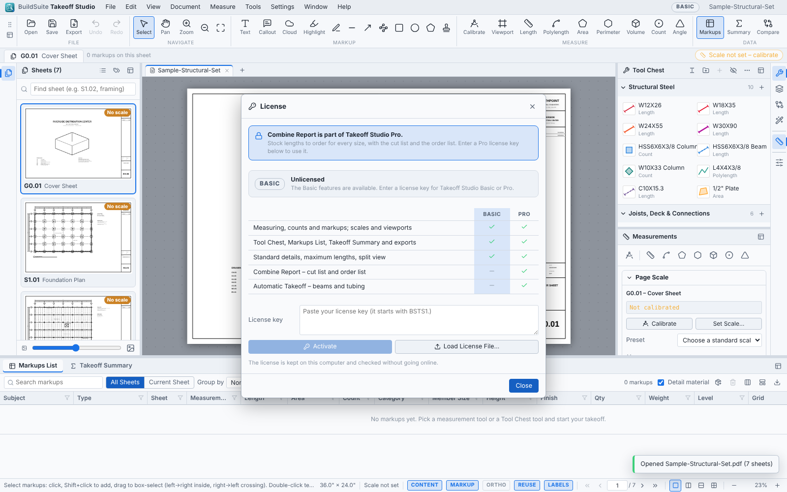

## How the requested workflow maps to the app

| Workflow step | Where it lives |
| --- | --- |
| **1. Sheet labeling & organization** | Sheets panel: thumbnails/list (a **slider** under the thumbnails sizes them – small ones sit side by side), search, drag to reorder, double-click to rename. *Document → Page Labels*: auto-detect from title blocks, **box the number and/or title once on any page** and read the same spot on all or the ticked pages, sequential numbering, or edit in a table. Each PDF is its own document, in its own **document tab**. |
| **2. Scale calibration** | *Calibrate* (two points + known distance such as `20'-0"`, `20-6`, `6.1 m`), *Set Scale* (architectural, engineering and metric presets or custom), apply to one / all / unscaled sheets. **Viewports** give a rectangular area of a sheet its own scale (details drawn at 1½" = 1'-0" next to a 1/4" section). Units: ft-in, decimal ft, in, m, cm, mm with selectable precision. |
| **3. Linear measurements** | Length and Polylength tools; results are persistent markup objects you can select, move, reshape by dragging vertices, restyle and inspect. Snaps to PDF line work (endpoints, midpoints, intersections, lines), to markup vertices, and Shift/ORTHO constrain angles. |
| **4. Area & perimeter** | Area (with perimeter shown), Perimeter, Volume (area × depth, CY/CF/m³), Angle; area **cutouts** for openings. |
| **5. Count** | Count tool: every click adds a symbol to the same count markup (circle, square, triangle, diamond, star, check, cross). A **Height** makes the count a length (each piece that long), a Width an area – see [Measurements panel](#measurements-panel). |
| **6. Custom markup tools** | **Tool Chest** with default sets (Structural Steel, Joists/Deck/Connections, Misc Metals, Concrete, Architectural & MEP, Review). Each tool stores type, subject, appearance, layer, depth and **column values** (Member Size, Grade, Category, Qty…). Create tools from scratch or from any markup, edit, duplicate, move between sets, import/export JSON. *Apply Tool Properties* restyles existing markups. |
| **7. Editable Markup List** | Bottom panel. Double-click cells to edit Subject (a shape from your list), Label, Comments, Status, Layer, Color, Author, Depth and every custom column; checkmark toggles. Multi-select edits apply to all selected rows. Undo/redo everything. |
| **8. Custom columns & data fields** | *Manage Columns*: Text, Number, Choice and **Formula** columns, ships with a structural-steel template (Piece Mark, Member Size, Material, Grade, Qty, Weight, Level, Grid, Detail, Connection, Labor Category, Notes, Category). Show/hide and reorder any column, resize by dragging headers. |
| **9. Sort, filter, group** | Click headers to sort, funnel icons for per-column value filters, search box, *Current Sheet* scope, *Group by* any text/choice column with per-group subtotals and a totals row. |
| **10. Drawing ⇄ data link** | Selecting a row navigates to its sheet, zooms and flashes the markup; selecting on the drawing highlights and scrolls to the row. Hover a markup for a quick readout. |
| **11. Takeoff summary** | Totals per subject and size (W24x55, HSS6x6x3/8…) grouped by Category (or any column): pieces (EA), length (LF), area (SF), volume (CY), Qty and every numeric/formula column (e.g. weight in lbs and tons). Click a line to select its markups. |
| **12. Export / report** | Markups CSV, summary CSV, printable summary report (save as PDF from the print dialog), flattened PDF with markups and measurement labels burned in. The takeoff itself is saved **inside each PDF**. |
| **Overlay / compare** | *Document → Compare / Overlay Sheets*: two sheets in their own colours, auto-aligned (text or image) or aligned by points / by hand, with change detection and revision clouds. See [Overlay / compare](#overlay--compare-sheets). |
| **Standard details** | *Tools → Standard Details*: IF a column (drop-down) equals a value (drop-down of the takeoff's values) → ADD material by subject, size and length, @ spacing OC, × quantity or full length – or add a detail by hand to any selected markups. See [Standard details](#standard-details). |
| **Automatic takeoff** | *Auto* button (*Tools → Automatic Takeoff*): finds the member-size labels on a plan (W24x55, HSS8x4x1/4, Pipe 4 Std…), measures the line each one labels at the sheet's scale and creates labelled length measurements, drawn by line style rules (*Settings → Auto Takeoff Line Styles*). See [Automatic takeoff](#automatic-takeoff-beams-and-tubing). |
| **Combine report** | *Tools → Combine Report* (or *Combine* in the Takeoff Summary): the stock lengths to order for each size, nesting the cut pieces on the lengths you can order per shape with a machine allowance per bar. See [Combine report](#combine-report). |
| **Subjects** | A markup's subject is its shape (W, HSS, L, BP, C, BO…) from a list you keep in *Settings → Subjects*. See [Subjects](#subjects-shapes). |
| **Settings & preferences** | *Settings* menu (`Ctrl+,`): general preferences, the project's units and totals, snapping and fine adjustment, **keyboard shortcuts**, **subjects**, auto takeoff line styles, **speed & graphics**, workspace. See [Settings](#settings--preferences). |
| **Documents** | Every PDF is its own document: its takeoff is saved inside it, with its own undo and Markups List layout; each has a tab, and tabs drag between panes and windows. See [Documents and tabs](#documents-and-tabs). |
| **Markups List layout** | Rename, move, show and hide columns per file; save the layout as the default for new files; export / import it. See [Markups List layout](#markups-list-layout). |
| **Flatten markups** | *Edit → Flatten Markups…* (or right-click): draws markups into the drawing itself. See [Flatten markups](#flatten-markups). |

### Tool Chest: size tools and hidden tools

* **Steel shape / size tools** – *Tools → New Steel Shape / Size Tool…* (or the I-beam button in the Tool Chest). Pick
  a shape family (W, HSS, L, C, MC, WT, S, HP, PL, Pipe, joists, or *Other* for any label), the measurement type
  (length, polylength, area, perimeter, volume, count…), line colour/width/style/ends, fill, symbol, layer and the label
  **font, size, bold and colour**. The tool shows a size box in the Tool Chest: type `24x68` (normalised to `W24x68`) and
  every markup placed with the tool is labelled `W24x68`, gets it as Member Size (so weights compute) and its shape **W**
  as Subject, and the
  size **stays with the tool – across sessions – until you type a different one**. Enter in the size box starts the tool.
* **Hide tools** – right-click a tool or set → *Hide Tool* / *Hide Set*. The eye button in the Tool Chest header shows
  hidden tools (dimmed) with per-tool and per-set eye toggles to bring them back.
* Any tool can be made a size tool from its properties (*Size / label tool*), and fonts are available on every tool.

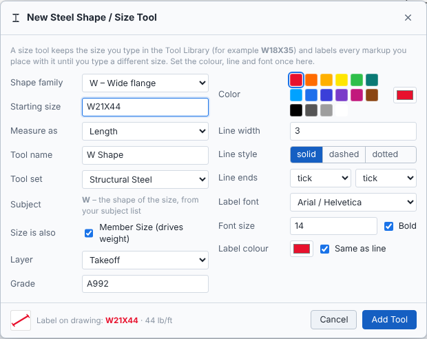

### Sizes

Sizes are written with a **capital X** – `W24X55`, `HSS6X6X3/8`, `L4X4X3/8` – the way they appear in the Markups List
and the exports. Type `*` (or `x`) for the X: `w8*10` becomes `W8X10`. A short shape code typed in lower case is
capitalised, and a **space after the shape is kept** if you type one: `W 8*10` becomes `W 8X10`. This applies to
Member Size cells and fields, size tools, labels that are sizes, detail material and the sizes the automatic takeoff
reads. Files from earlier versions are brought up to date when they open (W24x55 → W24X55), and so is the Tool
Chest. Weights (PLF/PSF) read sizes either way.

### Properties panel

For **measurements and counts** the Properties panel opens on its own when you draw a markup or select one (switch
this off in *Settings → General*) and shows only the main fields:

* **Subject**, **Label**, **Length** (the count, area or volume for those; the totals for several), **Height** and
  **Finish** (Galvanize, Prime, Paint, Powder Coat, Bare or anything typed).
* **Style** ▸ – folds open for the line and text styles and colours (colour, width, line style, ends, symbol, font,
  text colour, size, fill, opacity).
* **Properties** ▸ – folds open with a box for **every other column** of the Markups List (Piece Mark, Member Size,
  Material, Grade, Qty, Weight, Level, Grid, Notes, your own columns…) and Comments, Status, Layer, Author. The ☑
  button chooses which of them the list shows: hidden fields keep their values in the markup and in the Markups List.
* **Measurement** ▸ (scale, adjusting ends, count quantity, cutouts) and **Standard Details** ▸ fold open the same way.
  Each section stays open or shut as you left it.

Other markups (text, callouts, clouds, shapes) keep the full list of fields. Properties has its own section below the
Tool Chest on the right, so opening it leaves the Tool Chest showing; layouts from before are changed once to match.

### Measuring units

*Settings → Units & Totals → Measuring units* sets how you measure: **Feet-Inches** (`1'-1"`, the default), **Decimal
Feet**, **Inches**, **Meters**, **Centimeters** or **Millimeters**, and the precision (1/16" for feet-inches).

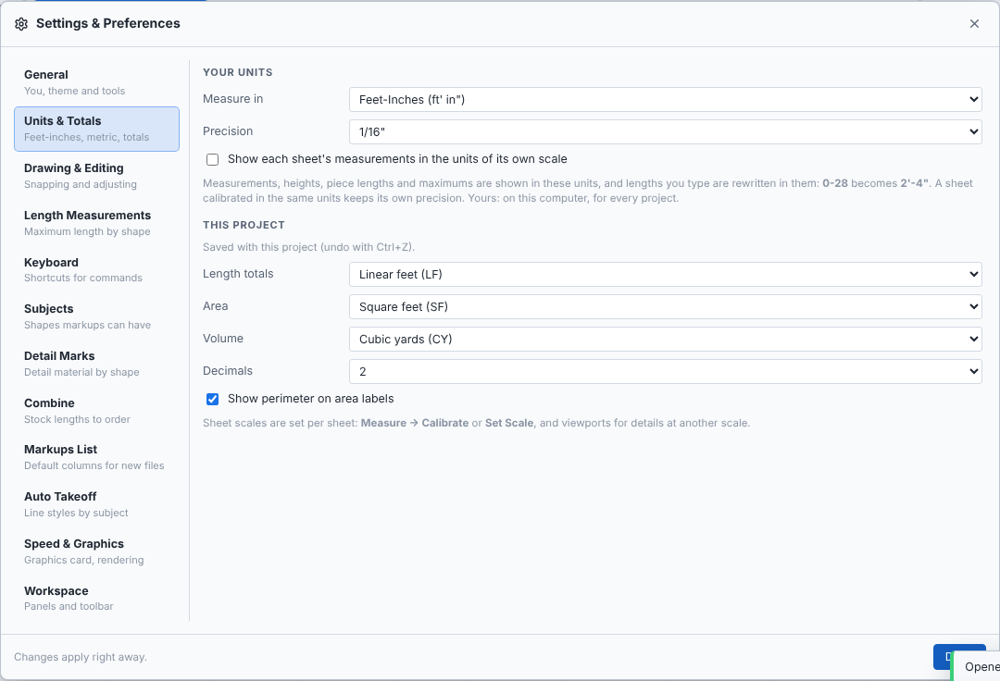

* Measurements on the drawing and in the Markups List, heights, standard detail piece lengths, maximum lengths, the
  selection totals and the Combine report are shown in your units. A sheet calibrated in the same units keeps its own
  precision; tick *Show each sheet's measurements in the units of its own scale* to leave every sheet as calibrated.
* **Lengths you type are rewritten in your units** when you finish typing: `0-28` becomes `2'-4"`, `1-1` becomes
  `1'-1"`, `13 1/2"` becomes `1'-1 1/2"`. Bare numbers are feet in feet-inches (inches where a field is in inches,
  such as standard detail lengths), inches in inches, and the metric unit in metric. Text that isn't a length is
  refused with a message.
* **Height** is a length: typed in your units in the Properties panel, the Markups List and Tool Chest tools, kept
  exactly, totalled in the document's length unit. Height shows in the Markups List for new files. Columns you add can
  be lengths too (*Manage Columns → Length*).

The document's units for **totals** (LF, SF, CY…) are set below, under *This project*.

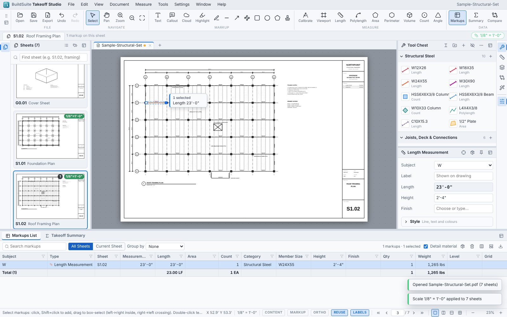

### Measurements panel

The **Measurements** panel sits between the Tool Chest and Properties on the right (each resized by the splitter
between them):

* **The measuring tools** in a row – Calibrate, Length, Polylength, Area, Perimeter, Volume, Count, Angle – the one in
  use highlighted (click it again to stop).
* **Page Scale** ▸ – the sheet's scale: Calibrate, Set Scale, a standard scale, its units and precision, *Apply to All
  Sheets*, and the sheet's viewports.
* **Count / Length / Area… Measurement Properties** ▸ – for the measurements selected:
  * **Subject** and **Label** (sizes written the standard way: `pl 1/2*7` → `PL 1/2X7`).
  * **Depth** with the unit its dimensions are written in (`ft' in"`, in, ft, m, cm, mm), **Width**, and for counts
    **Height**. Typed any way (`0-14` → `1'-2"`); bare numbers are inches for Depth and Width, feet for Height.
  * **A count with a Height takes off a length**: each piece counted is that long – 3 plates PL 1/2X7 with a Height of
    1'-2" are 3'-6" in the Length column, the totals, the weight (Length × PLF) and the Combine report. With a Width
    as well, the area (7" × 1'-2" × 3 = 2.04 sf); with a Depth, the volume.
  * A **length** has no Height: its **Width** makes it a strip with an area (a 2'-0" wide footing), and a Depth a
    volume. An **area** with a Depth has a volume.
  * **Length**, **Area** (and **Volume**) – the units this measurement is written in on the drawing and in the
    Markups List, instead of your units and the project's (totals stay in the project's units).
  * What it comes to: count, length, area and volume.
* **Totals & Display** ▸ – the project's units for totals.

The Markups List has a **Width** column (and Depth for counts and lengths too); Height is in the list for new files.

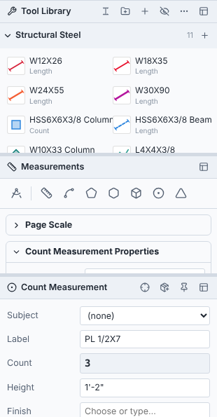

### Selection totals

Selecting markups – on the drawing or in the Markups List – shows a small box beside the selection with their
**totals**: 3 beams of 10'-0" show *Length 30'-0"*, 3 counts of 10 show *Count 30 EA*, areas add up their area, and the
material their standard details add is totalled too.

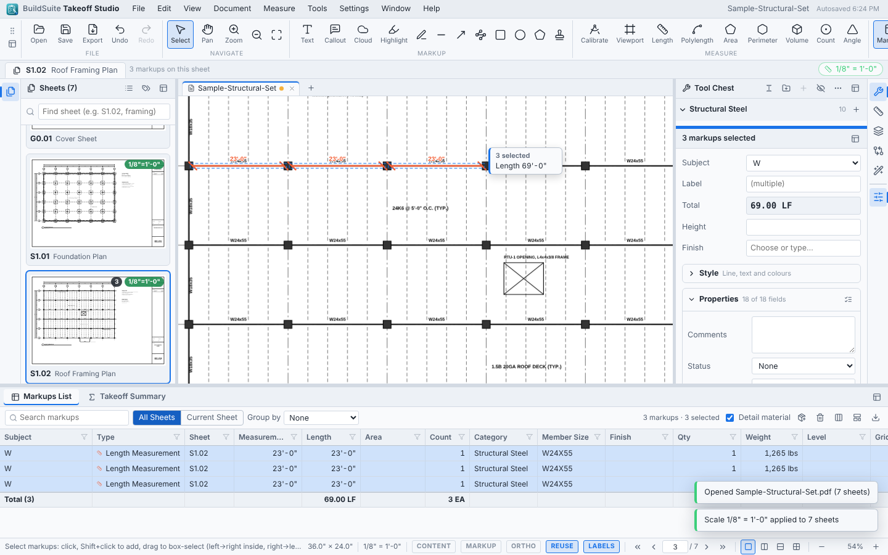

### Maximum lengths

*Settings → Length Measurements* (also *Settings → Length Measurements…*) sets the **longest piece of each shape** –
the length members come in, e.g. W and HSS at 40'-0", L at 20'-0". A length or polylength measurement longer than its
shape's maximum is **taken off as pieces along the same line**: with W at 40'-0", pulling a 63'-0" W24x55 makes **two
markups**, 40'-0" and 23'-0", end to end on the line you drew – two rows in the Markups List, each with the size,
subject and takeoff data of the tool. Full pieces come first from where you started, the rest last (an 85'-0" line:
40 + 40 + 5).

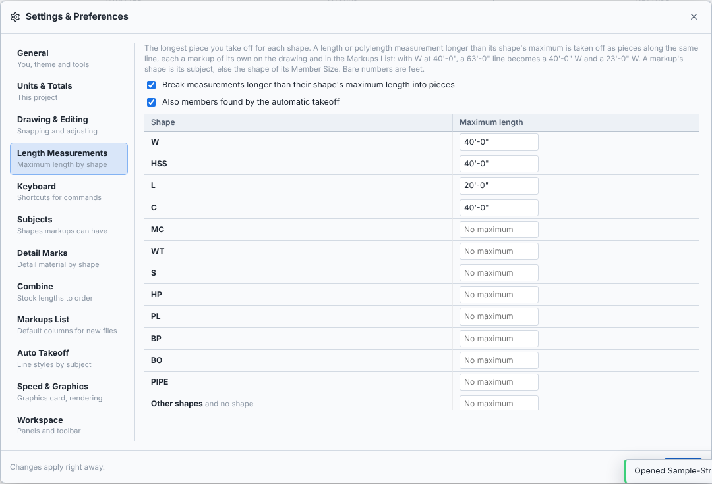

* The list has every shape in your subjects (*Settings → Subjects*), and **Other shapes** for markups whose shape has
  no maximum of its own or that have no shape. Blank means no maximum. Lengths are ft-in; bare numbers are feet.
  *Set Every Shape* fills them all at once; *Clear All* empties them.
* A markup's shape is its subject, else the shape of its Member Size (W24x55 → W) or label.
* Polylengths are cut where the distance along them reaches the maximum, so a piece can go round a corner.
* *Also members found by the automatic takeoff* breaks those the same way when you create them.
* Measurements already taken off: select them, right-click → **Split at Maximum Length** (on the drawing or in the
  Markups List), or *Edit → Split at Maximum Length*. One undo puts a broken measurement back together.
* Untick *Break measurements longer than their shape's maximum length into pieces* to switch it off.

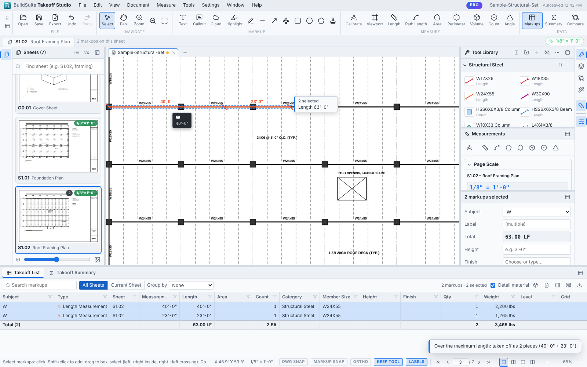

### Count editing

Select a count markup (or right-click it on the drawing or in the list):

* **Quantity** – type a number to override the counted symbols (shown with `*` in the list; *Reset* goes back).
* **Resume Count** – continue clicking symbols into the same count.
* **Split This Item** (right-click a symbol) / **Split All** – break symbols out into separate count markups with the
  same properties; *Remove This Item* deletes one symbol.

### Standard details

*Tools → Standard Details…* (also the package button in the Markups List and Summary, and *New Detail for This…* in a
markup's Properties) defines rules that add material wherever the takeoff matches:

```
IF [Member Size] = "W24X55"                          → ADD Clip Angle  L4X4X3/8  × 0'-11 1/2"  × 4 EA  GALV
IF [Subject] = "HSS" AND [Type] = "Count Measurement" → ADD Base Plate  PL3/4X12  × 1'-0"  × 1 EA
IF [Subject] = "PIPE" AND [Category] = "Misc Metals"  → ADD Post  HSS1-1/2X1-1/2X1/8  × 3'-6"  @ 4'-0" OC (+1)
```

* **IF** – pick the column from a drop-down, then the value from a drop-down of the values that column holds in the
  takeoff (*Other value…* to type one). Use *=*, *≠* or *contains*, and add more conditions (AND).
* **ADD** – one or more materials, each with **Subject**, **Size** and **Length** (each piece; bare numbers are inches),
  and how many: **@ spacing OC** along the measured length (an area's perimeter), with an optional end piece;
  **× quantity** per markup or per counted item; or **full length** of the measured run. The markup's Qty multiplies
  the result. Tick **Galv** on a material to make its *Finish* **Galvanize** (the rest keep the markup's finish).
* The added material appears under each matching markup in the Markups List (*Standard Detail*, read-only) and as its
  own lines in the Takeoff Summary and exports. Its **Length** is the length of **each piece** you typed (4 clip angles
  at 0'-11 1/2" show 0'-11 1/2" and a count of 4), and full-length material shows the measured run like its markup;
  totals, weights, the Summary and the Combine report use all of the pieces. The size fills Member Size, so Weight computes for it (steel shapes,
  plate, pipe, rod and rebar). *Detail material* in the list (or the summary) shows or hides it.
* **By hand** – select any markups (Ctrl+click or box-select in the drawing or the Markups List), right-click →
  **Add Detail to N Markups…**: a window lists every detail already made – tick one to add it to all the selected
  markups (untick to take it off; a dash means some have it), with a preview of the material it adds – or click
  **New Detail for These N…** to make a new one for them. The same is under *Properties → Add Detail…*. The Properties panel shows a checkbox per detail for the
  selection, and the editor has **Add to Selected / Take off Selected**. A detail with *Apply automatically* off goes
  only where you add it; one with a rule still lets you add it to other markups or take it off single ones by hand.
  *Back to Rules Only* drops the by-hand changes.
* The editor shows the rule as a formula and a live preview of pieces, length and weight. Details are saved with the
  document (its PDF) and work only there – each file has its own details; export/import them as JSON to use them in
  another file. The example takeoff includes four.

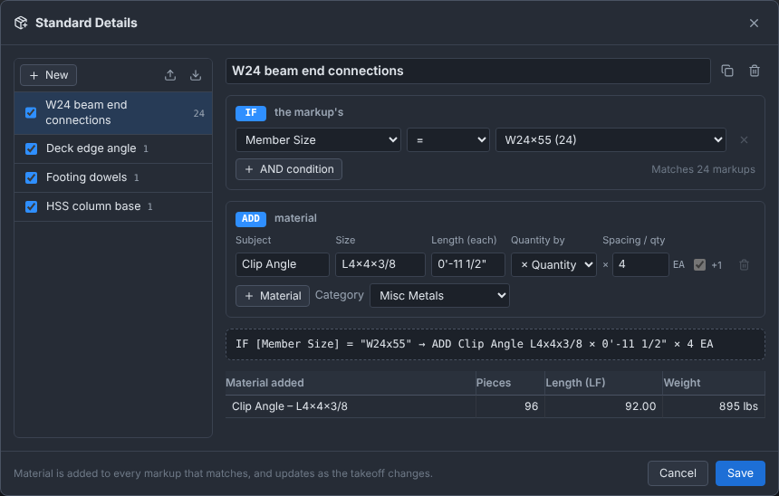

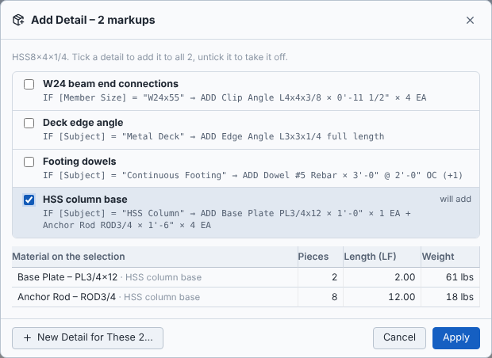

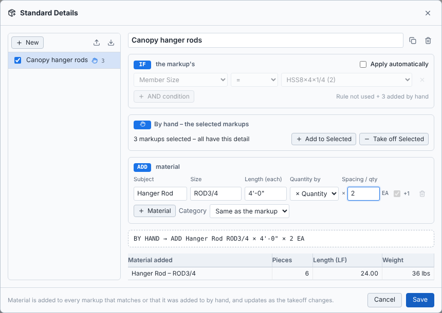

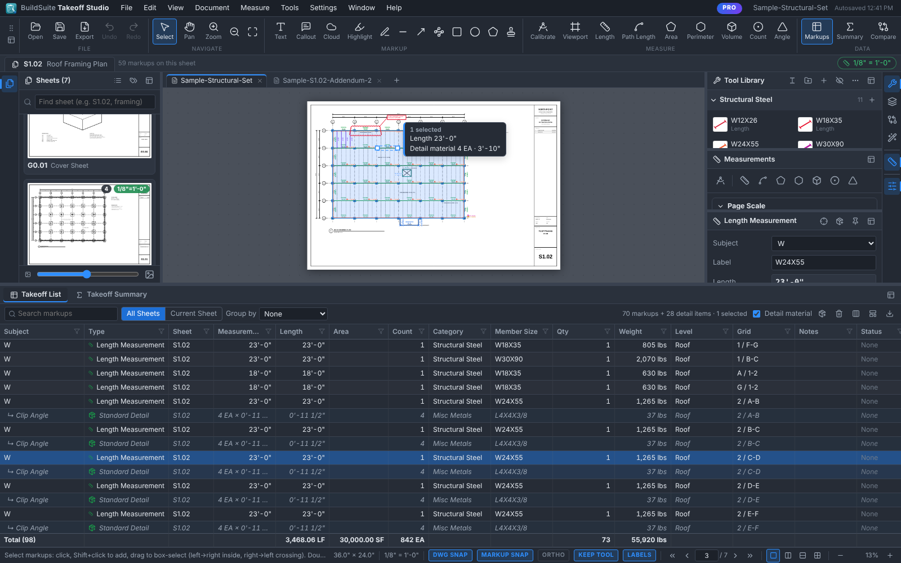

#### Detail material on the drawing

Whatever a standard detail adds – by its rule or by hand – is also **drawn next to its markup**, a little to the side so
the markup, its label and the material all stay readable:

* **Full length** material is a **line the same length and in the same direction** as the markup (a polylength's line
  follows every bend), on the side away from the markup's label; around an area it runs just inside the outline. The
  size is written along it.
* **@ spacing** pieces are a **mark for every piece**, where it falls along the member (posts at 4'-0" OC, studs,
  dowels), with "13 × 3/4" stud @ 2'-0"".
* **× quantity** pieces are a **count mark next to the markup's label** with the number of pieces ("4 × L4x4x3/8");
  several are stacked by the label. On a count markup the mark goes by its count label.
* Each is drawn in the **look set for its shape** in *Settings → Detail Marks* (also *Settings → Detail Marks…*). A
  material's shape comes from its size (L4x4x3/8 is an L, HSS1-1/2x1-1/2x1/8 an HSS), else its subject. For each shape:
  * **Count marks** (× quantity and @ spacing): show or not, the **symbol** (circle, square, triangle, diamond, star,
    check, cross), its **size**, **colour**, and the **label** (number of pieces and size) on or off;
  * **Lines** (full length): show or not, **solid / dashed / dotted**, the **width**, **colour**, and the **label**
    (size) on or off.

  Add a shape (pick from your subjects or type one, e.g. RB), remove one, or *Reset to Defaults*. **Other shapes** is
  the look for material whose shape is not listed (rebar, studs…). A sample of each look is shown in the list. The
  text size (a share of the markup's label size) and the space from the markup are set at the top.
* The material moves with its markup and goes away when the detail is taken off; it is not a markup of its own, so it
  is still counted once. Hover it to see the detail and the quantity; click it to select its markup.
* Draw it or not: *Settings → Detail Marks*, or *View* / *Settings* menus → *Standard Detail Material on Drawing*.
  Flattened PDFs (*Edit → Flatten Markups*, *File → Export → Flattened PDF*) draw it too.

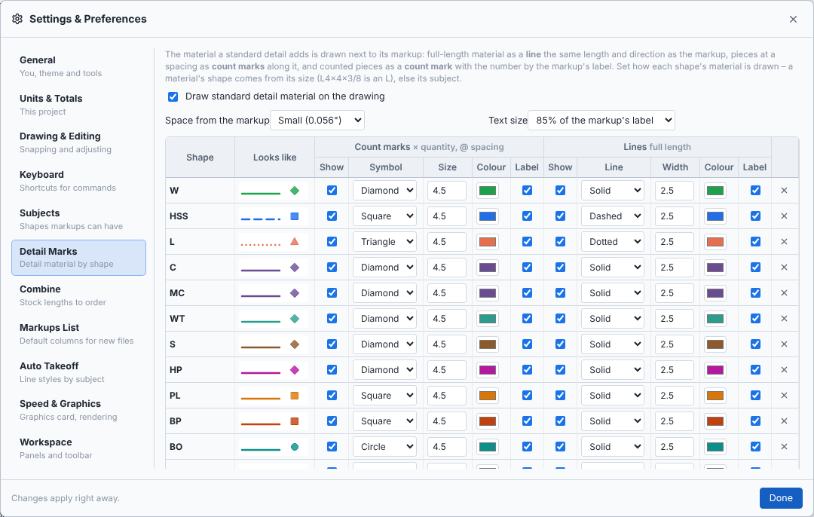

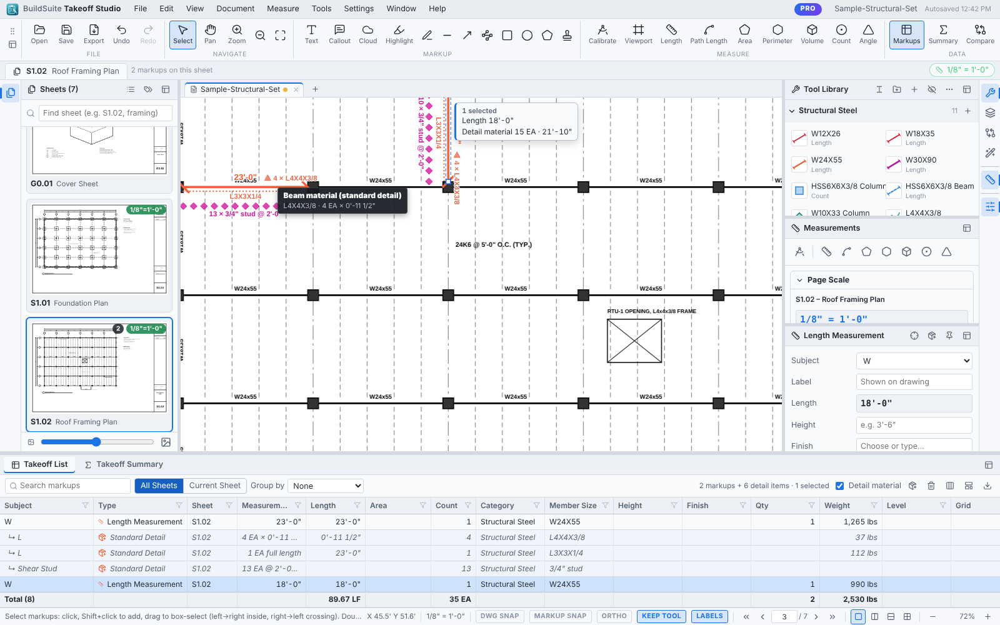

### Automatic takeoff (beams and tubing)

Open the **Auto** panel (toolbar, or *Tools → Automatic Takeoff (Beams & Tubing)…*) on a framing plan and click
**Find Members**:

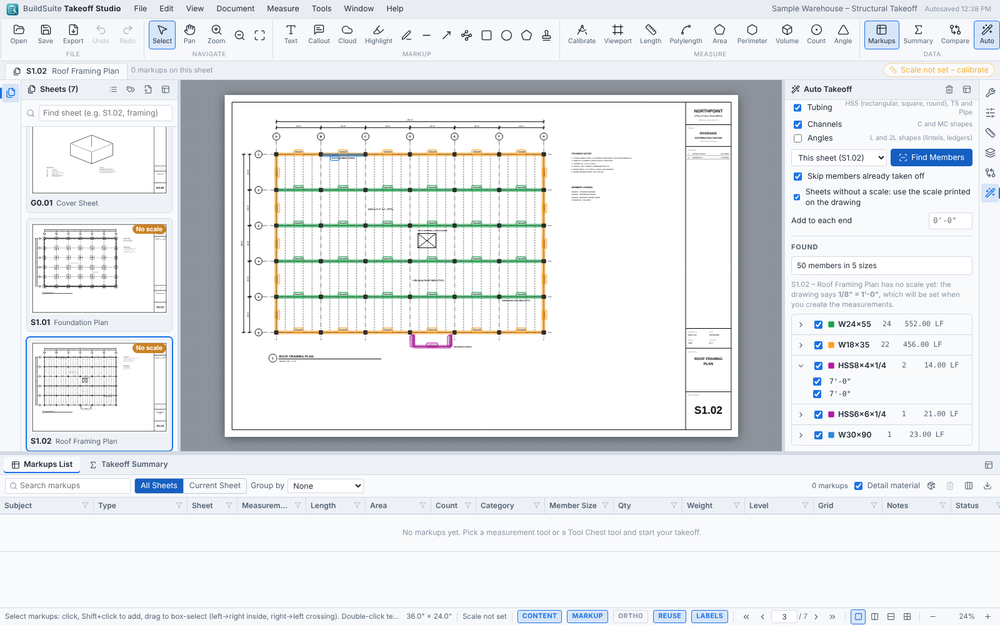

* It reads the PDF's own text and line work: every **member-size label** – W, S, M and HP beams, HSS (rectangular,
  square and round), TS and Pipe tubing, C/MC channels, optionally L angles – and the **line it labels**: the line that
  runs parallel to the text, right beside it, under the middle of the label. Solid lines win over dashed grid and hidden
  lines, heavy ones over hairline dimension lines. Labels that name columns (*HSS6x6x3/8 COLUMNS*) are skipped –
  columns are counted, not measured.
* **Where a member starts and stops** – collinear pieces that touch (a girder broken where beams frame in) are joined
  into one line first. A line that ends is a member end. When a line runs on through its columns with one label per
  span, it is split **at the column symbols drawn on it** (squares, filled squares, round or I-shaped columns) – the
  nearest column on each side of each label. Where no column is drawn between two labels on the same line, it is split
  **halfway between the labels**; those ends are marked *est. end* (orange square on the drawing) to check.
* **Scale** – lengths use the sheet's scale (and viewport scales inside details). A sheet with no scale yet uses the
  scale printed on the drawing (`SCALE: 1/8" = 1'-0"`) when there is exactly one, and that scale is set on the sheet
  when you create the measurements; otherwise the panel asks you to calibrate.
* **Review** – the members are previewed on the drawing with the line they will get and the label they were read from
  boxed. The panel groups them by size with count and total length; untick a size, expand it to untick single members,
  or click a member on the drawing to leave it out. *Skip members already taken off* leaves out members an existing
  length measurement covers, so it can be run again after more work. *Add to each end* lengthens every member (e.g. to
  the grid lines or column centres).
* **Fine adjustment** – drag the square at either end of a member: it slides along the member and snaps to the drawing
  (grid lines, column corners), so a beam drawn short of the grid can be taken to the grid line; hold Alt to move the
  end freely, Ctrl to turn snapping off. Pick a member in the list to zoom to it and get **− / +** buttons for the left /
  right (or top / bottom) end and both ends, with a step from 1/16" to 1'-0". Adjusted members are marked and can be
  put back as found.
* **Line styles** – *Settings → Auto Takeoff Line Styles* sets the line by subject: rules such as *starts with* **W** →
  green solid, *starts with* **HSS** → blue dashed (colour, **text colour** for the size label – or the same as the line –,
  width, solid/dashed/dotted, opacity). The first matching rule
  wins; without one, the Tool Chest tool for the size (e.g. *W24x55*) or a colour per size is used. *Apply to Existing
  Auto Measurements* restyles the ones already made.
* **Create** – one length measurement per member in one undo step, labelled with its size, with the size as Member Size
  and its shape (W, HSS…) as Subject (so Weight computes and standard details apply). When the Tool Chest has a length tool for the size, its
  layer and column values are used. Afterwards, any straight length measurement (or several at once) can be adjusted in
  **Properties → Adjust Ends**: − / + per end by the step, or type an exact length.

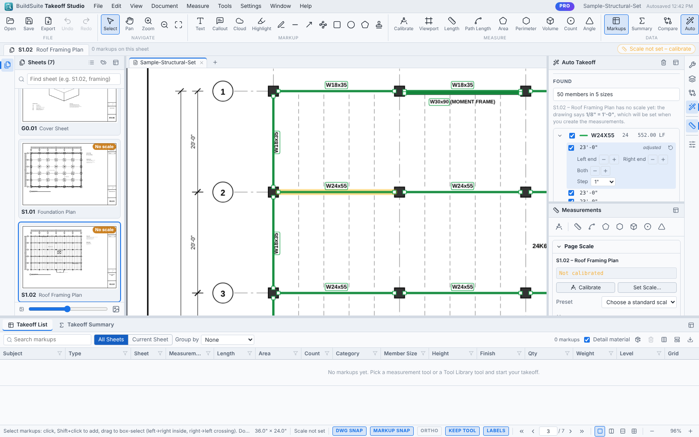
* Search one sheet or all sheets. The example takeoff's roof beams and canopy tubes were taken off this way.

### Settings & preferences

The **Settings** menu opens *Settings & Preferences* (also `Ctrl+,` and *Edit → Settings & Preferences…*) and has quick
switches for snapping, ortho, reuse, labels, theme and the workspace layout:

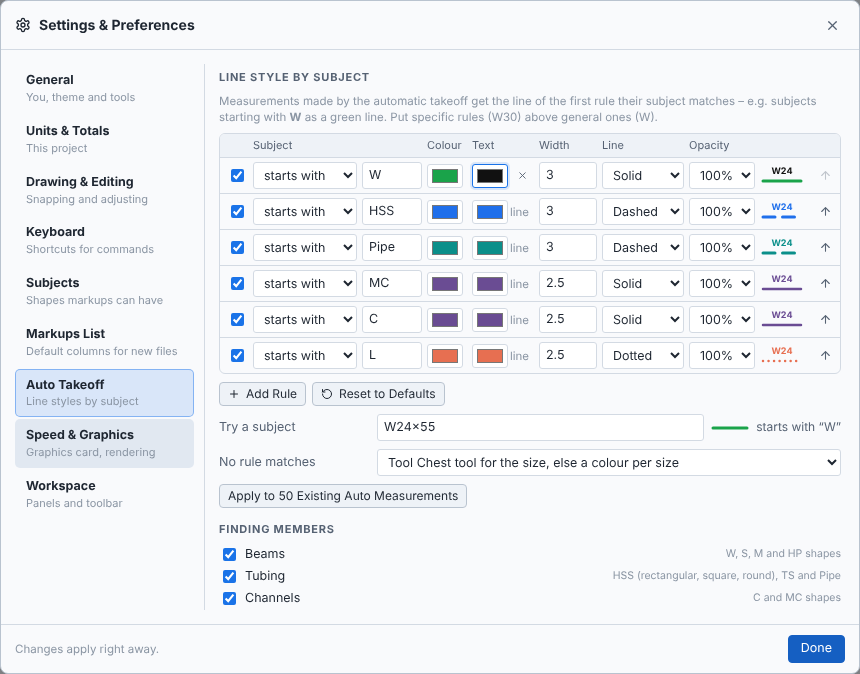

* **General** – author name for new markups, theme, mouse wheel (zoom or scroll), measurement labels on the drawing,
  keep tools active, show the Properties panel when a markup is drawn or selected, show hidden Tool Chest tools.
* **Units & Totals** – the units you measure and type lengths in (see [Measuring units](#measuring-units)); the document's
  units for totals (LF/in/m, SF/SY/m², CY/CF/m³), decimals and perimeter on area labels, saved with the document.
* **Length Measurements** – the maximum length of each shape (see [Maximum lengths](#maximum-lengths)).
* **Drawing & Editing** – snapping to the drawing and to markups, ortho; what the arrow keys move a selection by (screen
  pixels, or a drawing length such as 1" at each markup's own scale – Shift ×10); the step for adjusting ends; standard
  detail material on the drawing (see [Detail material on the drawing](#detail-material-on-the-drawing)).
* **Keyboard** – every command with its keys: click **+** and press the keys to add a shortcut, × to remove one,
  *Default* to put a command back, *Reset All*. Single keys (like `L`) work on the drawing; add Ctrl, Shift or Alt for
  more. A key already used by another command is flagged, with the choice to move it. Search by command or by key.
  The menus, tooltips and *Help → Keyboard Shortcuts* show your keys.
* **Subjects** – the shapes markups can have as subject (see [Subjects](#subjects-shapes)).
* **Combine** – the stock lengths you can order for each shape, the machine allowance and the kerf (see
  [Combine report](#combine-report)).
* **Auto Takeoff** – line styles by subject (above) and the defaults for finding members.
* **Speed & Graphics** – see [Speed and graphics](#speed-and-graphics).
* **Detail Marks** – how standard detail material is drawn, shape by shape (see
  [Detail material on the drawing](#detail-material-on-the-drawing)).
* **Workspace** – lock the layout, toolbar position, reset the layout.

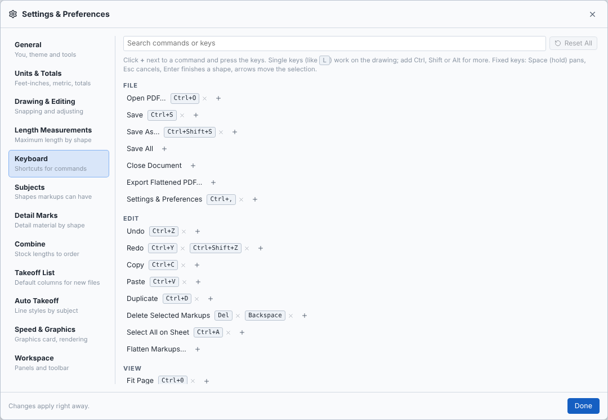

* **Markups List** – the default Markups List layout for files you open from now on (see
  [Markups List layout](#markups-list-layout)).

Preferences, your units among them, are kept on the computer and apply to every document; the units for totals belong to the document.

### Subjects (shapes)

A markup's **subject is the shape** it takes off – **W, HSS, L, C, MC, WT, S, HP, PL, BP, BO, PIPE** to start with – and
the size itself (`W24x55`) is its Member Size and label. Subjects are picked from a list (the Subject cell of the
Markups List, *Properties* and the Tool Chest tool editor) rather than typed.

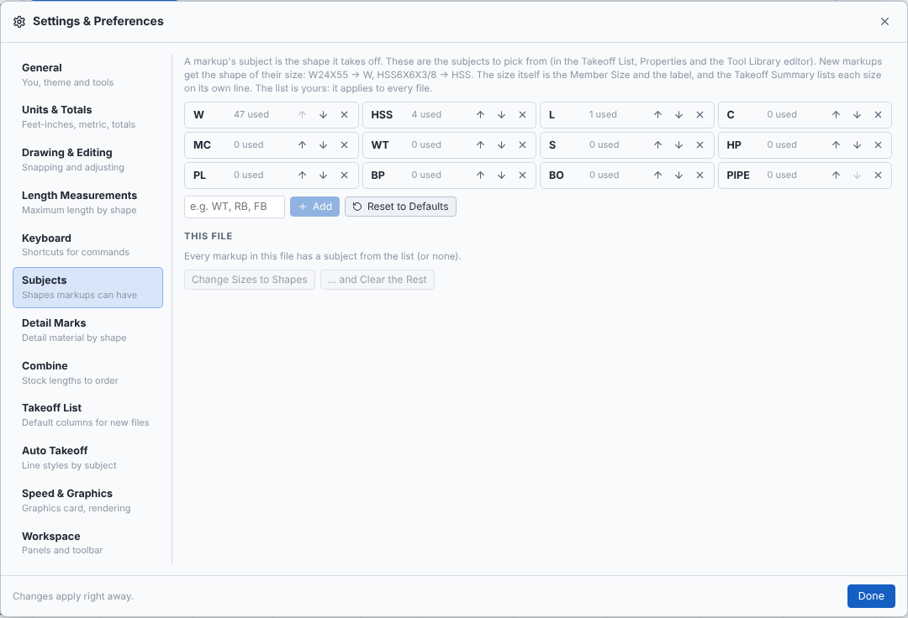

* *Settings → Subjects* is your list: **add** a shape (e.g. RB, FB), **remove** one, reorder them, or reset to the
  defaults; it applies to every file. The list shows how many markups in the open file use each one.
* New markups get the shape of their size from the list: a size tool's size, else the Tool Chest tool's own subject,
  else the shape of its Member Size (W24x55 → W, HSS6x6x3/8 → HSS, MC12x10.6 → MC, Pipe 4 Std → PIPE). Markups whose
  size has no shape in the list (deck, joists, notes, clouds) have no subject. The automatic takeoff does the same.
* The **Takeoff Summary** puts each size on its own line (`W24x55`, `W18x35`…, or the shape and the size, e.g.
  `BP PL1/2x8`).
* Files from before have subjects such as `W24x55` or `HSS Column`; the Markups List shows subjects not in the list in
  italics. *Settings → Subjects → Change Sizes to Shapes* turns them into shapes (W24x55 → W, the size going into Member
  Size when that is empty); *… and Clear the Rest* also clears the ones that name no shape. One undo step.

### Combine report

*Tools → Combine Report…* (also *File → Export → Combine Report*, and the **Combine** button of the Takeoff Summary)
works out the material to order. It reads the size of every length measurement (its Member Size, else its label) and
its length, and nests the pieces of each size on the stock lengths you can order for its shape, using as little
material as it can:

* 3 × W8x10 at 5'-0" fit on **one 20' beam** (15' + the 1' machine allowance = 16').
* W8x10 at 15'-0" and 2 at 18'-0" need **one 40' and one 20'** when W comes in 20' and 40' (18' + 18' + 1' on the
  40', 15' + 1' on the 20'). With every 5' length from 20' to 60' to choose from, it orders one 55' instead (52' of
  pieces + 1'), which is less material. Two plans that use the same length go to the one with fewer bars.

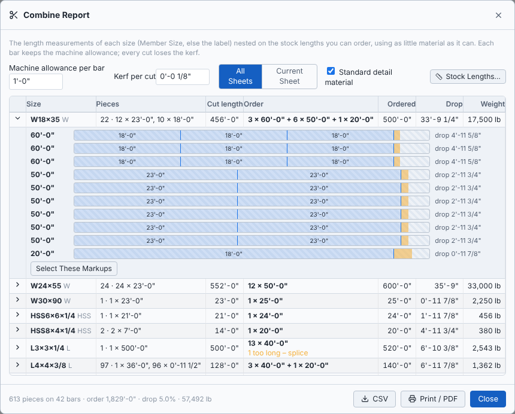

* **Machine allowance per bar** – the length every bar keeps for the machine (usually about 1'-0"), and the **kerf**
  lost at each cut (1/8" to start with). Change them in the report or in *Settings → Combine*; bare numbers are inches.
* **Stock lengths per shape** – *Settings → Combine* lists the lengths you can order for each shape (W: 20' to 60'
  every 5'; HSS: 20', 24', 40', 48'; L, C, MC, WT, S: 20', 40'; HP: 40' to 60'; PIPE: 21', 42'). Add a length (`32`,
  `32'`, `9.75 m`) or click × to take one off; **add or remove shapes** like everywhere else; *Reset* puts the defaults
  back. Sizes whose shape is not in the list (joists, rebar, plate…) use the lengths under *Other*; with none there,
  they are listed in the report but not planned.
* Each row shows the pieces, their total cut length, **what to order** (`1 × 40'-0" + 1 × 20'-0"`), the length ordered,
  the drop and the weight ordered (from the steel tables). Click a row for its **cutting plan**: every bar drawn to
  scale with its pieces, the machine allowance and the drop; *Select These Markups* finds them on the drawing.
* Quantities count: a markup with Qty 3 is three pieces. Material added by **standard details** (clip angles,
  posts…) is included (untick *Standard detail material* to leave it out). *Current Sheet* plans one sheet only.
* A piece **as long as a stock length** (to 1/16") is ordered **whole**: it is that bar, so nothing is cut and no kerf
  or allowance is taken. Five 40'-0" angles with L in 20' and 40' are five 40' bars, *full length – no cut*, drawn solid
  in the cutting plan.
* A piece longer than the longest stock length is **spliced** from whole bars and one cut piece – the combination that
  orders the least (63'-0" of W: 40' whole + 23' cut from a 25', not 60' + 3'). The cut pieces of spliced members
  (marked ⧉) are **nested with the other pieces**, so two 42'-0" angles take two whole 40' bars and their two 2'-0"
  rests share one 20' bar. The report flags spliced pieces.
* A piece just shorter than the longest stock but too long to keep the machine allowance on it is **trimmed** from
  that bar (one cut, no allowance) rather than spliced.

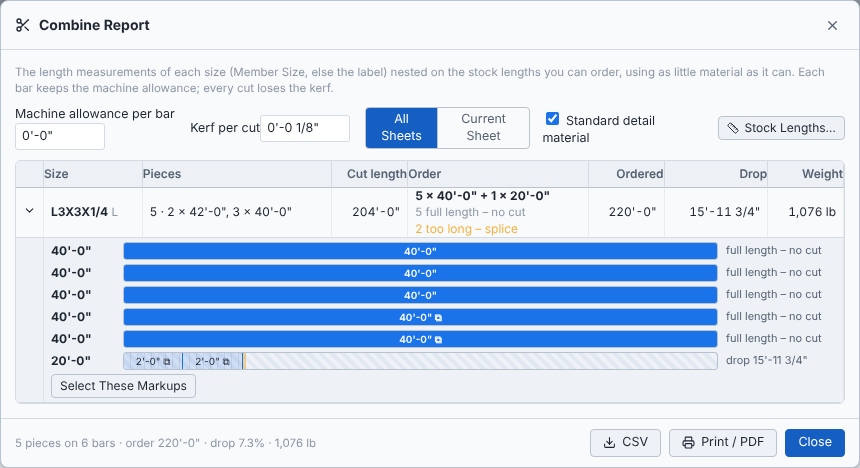
* Exports: **CSV** (the order list and the cutting plan) and **Print / PDF** (a printable page with the bars drawn).
* **Create Report** makes a simple list from the same plan (its sheets, detail material and stock lengths). Choose:
  * **Order List** – the material to order, one line each: the size, the length and how many (`L3X3X1/4   40'-0"   6`,
    then `L3X3X1/4   20'-0"   1`). Sizes whose shape has no stock lengths list their lengths as cut (marked *).
  * **Cut List** – each size with its bars, bars cut the same way together: how many, the stock length, what is cut
    from each (`2 × 11'-6", 15'-0"`) and the drop; whole bars read *full length – no cut*, pieces of spliced members ⧉.

  Then **Print / PDF** (a plain page), **CSV**, or **Copy** – the list as text in lined-up columns (spaces, no dashes) to
  paste into an e-mail or a purchase order.

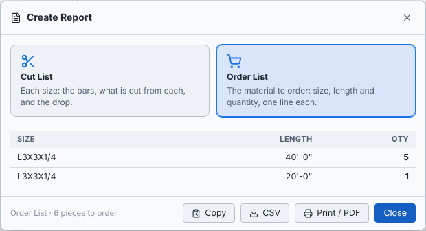 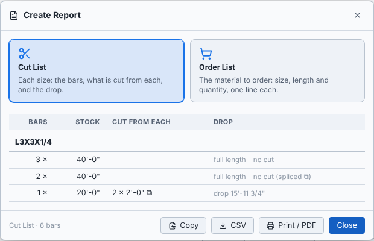

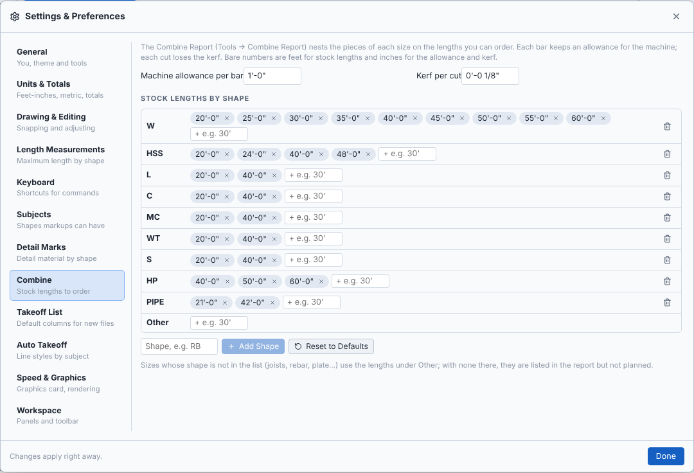

### Labels and text colour

Labels and text have their own colour, separate from the line: *Properties → Text colour* (tick *Same as line* to
follow the line again), the Tool Chest tool editor and size tools (*Label colour*), and each automatic takeoff line
style rule (*Text*). Measurement labels, text boxes, callouts and stamps use it, on the drawing and in flattened PDFs.

### Overlay / compare sheets

Compare two versions of a drawing: *Document → Compare / Overlay Sheets…* (or the
**Compare** button). Open the revised PDF first (*File → Open PDF…*): sheet B can be a sheet of the same document or
of any other open document, and the revision of the same sheet number is suggested.

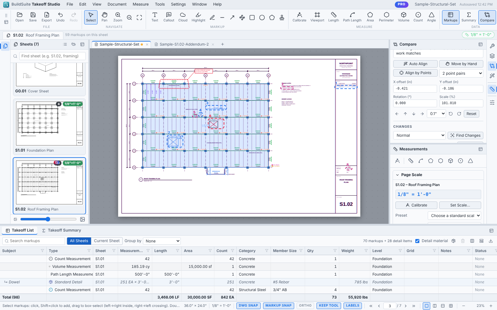

* **Colours** – sheet A and sheet B each draw in their own colour (red/blue by default, presets or any colour) and
  multiply: line work on both sheets shows dark, what is only on A shows in A's colour, what is only on B in B's.
  Each sheet has an **intensity** slider and an eye button to hide it; *Overlay on* switches the whole overlay off and
  on.
* **Auto Align** – matches the text both sheets share (titles, notes, grid bubbles, member labels) and fits shift,
  scale and rotation, so revisions plotted at a different size or position line up exactly; scans without text are
  aligned by image correlation. The panel shows how much of the line work matches after aligning.
* **Manual alignment** – *Align by Points*: click 2 or 3 sharp features (grid intersections, corners) on sheet A, then
  the same features on sheet B; each step shows only the sheet being clicked and snaps to its line work. *Move by Hand*
  drags sheet B; arrow buttons nudge it by 0.01", 0.1" or 1"; X/Y offset, rotation and scale can be typed exactly.
* **Find Changes** – boxes and lists every difference (*Only on A*, *Only on B*, *Changed*). Line work is compared as
  images and text as text, so a single changed digit in a note is found. Click a change to zoom to it; **Add Clouds**
  adds a *Revision Change* cloud markup around each one (one undo step).
* The overlay is saved with sheet A's document; when sheet B is in another file, that file needs to be open to show it
  (the Compare panel says which). It works in split and detached panes. Markups and measurements stay on
  sheet A. The example takeoff includes Addendum 2 of S1.02 with an overlay ready to switch on (Compare panel →
  *Overlay on*).

### Documents and tabs

Every PDF is **its own document**. *File → Open PDF…* (`Ctrl+O`), the Open button or dropping PDFs on a pane opens each
one in a new tab of that pane. A document's markups, sheet labels, scales and viewports, custom columns, layers,
standard details, overlays and Markups List layout belong to that file only, and it has its own undo history.

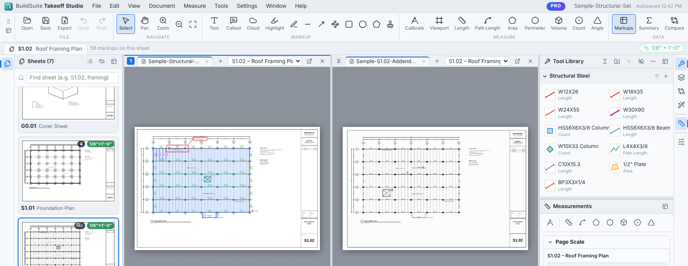

* **Saved inside the PDF**: *File → Save* (`Ctrl+S`) puts the takeoff into the PDF itself (as an embedded file the PDF
  carries along, so the drawing looks the same in any PDF viewer). Open that PDF again – here, on another computer, or
  after e-mailing it – and the takeoff is back. In the desktop app *Save* writes back to the file it was opened from;
  *Save As…* (`Ctrl+Shift+S`) asks where. In a browser the PDF is downloaded. *Save All* saves every changed document.
  A PDF that is protected against changes is saved as a `.takeoff.json` file instead (open that to carry on).
* A dot on a tab marks unsaved changes. Closing a document with unsaved changes asks whether to save it first. Open
  documents (saved or not) also come back when the program starts again.
* Click a tab to show that document; each tab remembers the sheet it was on. The Sheets panel, Markups List, Takeoff
  Summary, Layers and Measurements panels show the active document. `Ctrl+Tab` / `Ctrl+Shift+Tab` (also
  `Ctrl+Shift+]` / `[`) go to the next and previous tab; `Ctrl+F4`, the × or a middle click closes it.
* **Move a tab to another pane**: drag it onto another pane's tabs or drawing (hold `Ctrl` to show it in both), or
  right-click it → *Move to Pane* / *Also Show in Pane* / *Move to New Pane* / *Move to New Window*. Drag along the
  tabs to reorder them. Tabs drag into detached windows too. A pane whose last tab moves away closes. **+** at the end
  of the tabs opens a PDF, or shows a document open in another pane here.
* Opening a file that is already open shows its tab. Takeoff project files from earlier versions (`.takeoff.json`,
  several PDFs in one) open as one document per PDF.

### Markups List layout

Each file keeps its own Markups List layout: which columns show, their order, widths and header names, and its custom
columns.

* **Rename** a column header: double-click it, or right-click → *Rename Column…* (the column keeps its own name in
  formulas). **Move** a column by dragging its header, or right-click → *Move Left / Move Right*. **Hide** one from the
  same menu; *Columns…* shows, hides, orders and renames them all and edits custom columns.
* The **list style button** in the Markups List toolbar (and the header menu): *Save as Default Style* – files you
  open from now on start with this layout; *Apply Default Style* / *Reset to Built-in Style* for this file;
  *Export This Style…* / *Export Default Style…* to keep a copy (a backup, or to use on another computer);
  *Import Style…* (this file) and *Import as Default Style…*. Importing adds the style's custom columns, or updates the
  file's columns of the same name.
* *Settings → Markups List* shows the default layout, with the same save, export, import and reset.

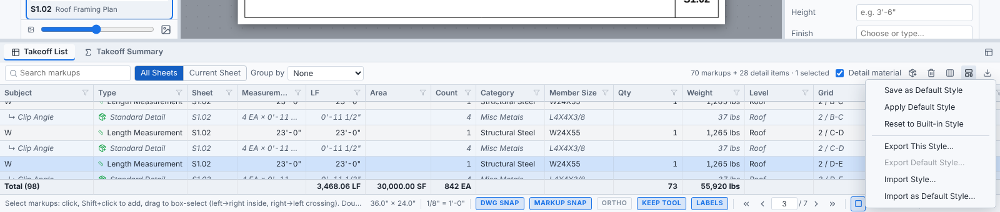

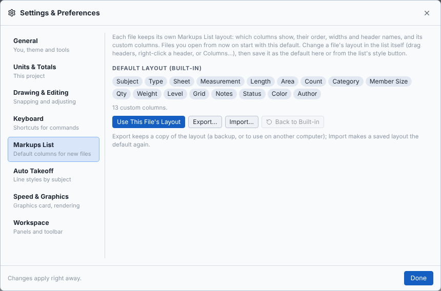

### Split view and workspace layout

* **Split the document as many times as you want**: *Window → Split Vertical / Split Horizontal / Split Four Ways*,
  the status-bar buttons, or the keys – **Ctrl+Shift+2** side by side, **Ctrl+Shift+3** one above the other,
  **Ctrl+Shift+4** four ways. Each split splits the **active pane** again (the new pane becomes the active one), so
  panes can be split inside splits in any mix; splitting beside panes already side by side shares the space evenly.
  Change the keys in *Settings → Keyboard*.
* **Panes are closed by hand**: the × in a pane's header (the pane's documents stay open in the others), or *Window →
  Single View (Close Other Panes)* for all but the active one – it has no key unless you give it one. Each pane has its
  own document tabs, sheet selector, zoom and pan; the active pane is outlined and receives tools. Drag a divider to
  resize the panes beside it.

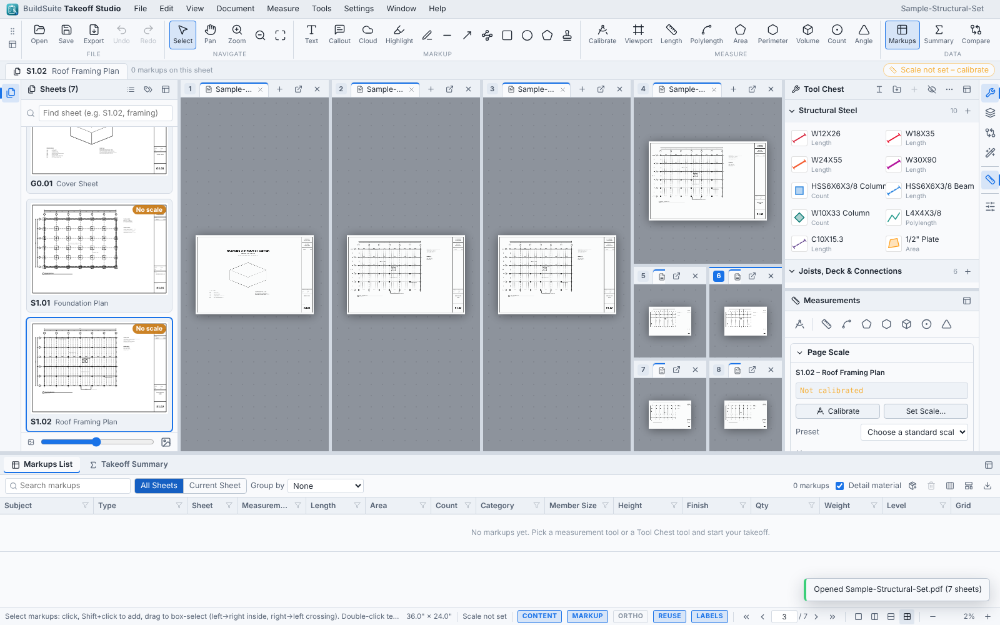

* **Detach a pane** with the ↗ button in its header (or *Window → Detach Active Pane*). In the desktop app it becomes
  its own window you can move to another monitor and resize; in a browser that blocks pop-ups it floats inside the
  app (drag its header to move, the corner to resize). A detached pane uses the main window's toolbar, menus and
  panels, and whichever pane or window you click is the active one. Put it back with the header button, or close its
  window to close the pane.
* Tools stay on when you move between panes and windows, so you can measure in one and carry on in another. The
  **count** tool starts a new count when you switch to another pane, window or sheet.
* **Panels** (Sheets, Tool Chest, Properties, Measurements, Layers, Markups List, Takeoff Summary) dock to the
  **left, right, top or bottom**, or **float** in their own movable, resizable window. Drag a panel's header or tab
  (drop zones appear at the edges; drop elsewhere to float) or use its layout menu. The **toolbar** docks top, left,
  right or floats the same way.
* **Each dock splits into up to four sections** (three splits), each with its own tabs and its own open panel – e.g.
  the **Sheets thumbnails and the Tool Chest on the left at the same time**, or the Markups List beside the Takeoff
  Summary at the bottom. Drag a panel onto the lower quarter of a section in a side dock (the right quarter in the top
  or bottom dock) to split a new section there – the place lights up – or onto the rest of a section to add it to
  that section's tabs; or use the panel's layout menu: *Split Below / Split Right (New Section)* and *Move to Section*.
  Drag the splitter between sections to size them (heights down a side, widths across the top or bottom), and the
  dock's edge for its width or height. A section emptied of panels closes up; each section collapses and opens on its
  own from its tabs. The side tab strips group the tabs by section.
* **Side panels are always resizable**: drag the dock's edge for its width, the splitters between sections for their
  heights. In a narrow window, where a side panel lies over the drawing, drag the grip on the panel's edge.
* The right dock starts with the **Tool Chest, Measurements and Properties stacked**; layouts from before get
  Measurements in its own section below the Tool Chest once.
* *Window → Lock Workspace Layout* stops accidental moves; *Reset Workspace Layout* restores the default. The layout is
  remembered between sessions.

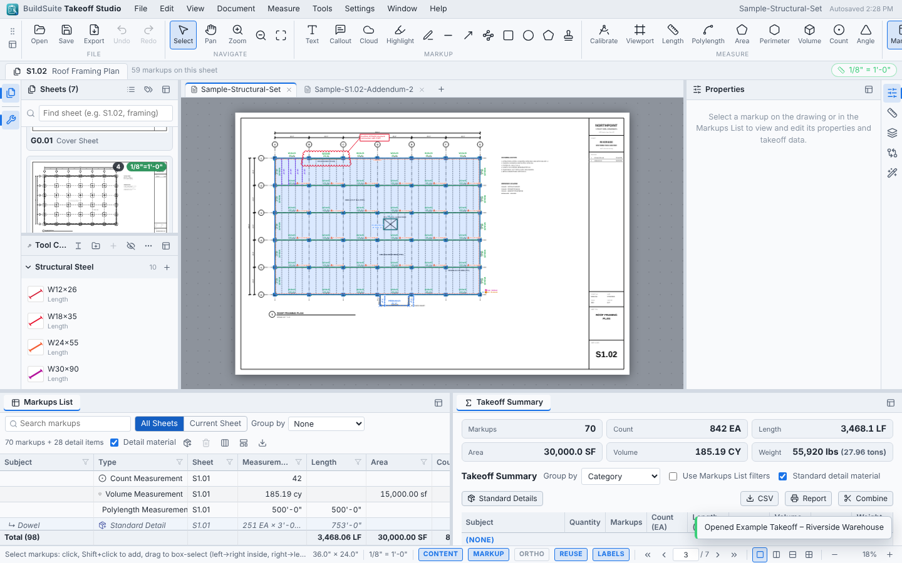

### Program windows

Every program window (Settings, Standard Details, Combine Report, Calibrate, Columns…) **moves**: drag its title bar to
see what is behind it (double-click the title bar to centre it again); it opens where you left it for the rest of the
session. Windows **don't dim** the program, and the drawing and panels behind them keep working – pan to look at the
drawing, select markups – while a window is open. *Esc* or × closes it.

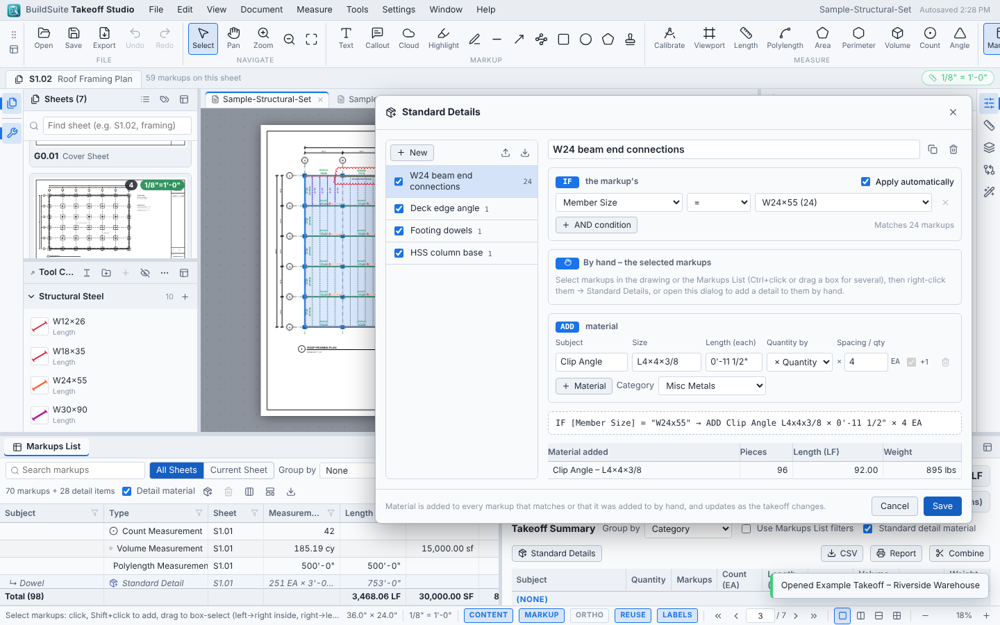

### Page labels from a box

*Document → Page Labels from a Box…* (or right-click the drawing, or *Read from a Box on the Page…* in *Document →
Page Labels*): drag a box around the sheet number, the title, or both in one title block. The same spot is read on
**every page, or only the ticked ones** (*All*, *None*, *This File*, *Unlabelled*, or tick pages one by one), and the
dialog shows what was in the box on each page next to the number and title it gives. Whether the box holds the number,
the title or both is guessed from the page you drew it on and can be changed; captions such as *SHEET NUMBER* or
*DRAWING TITLE* are left out. Review, edit any cell, and *Apply* (one undo step). Scanned pages have no text to read.

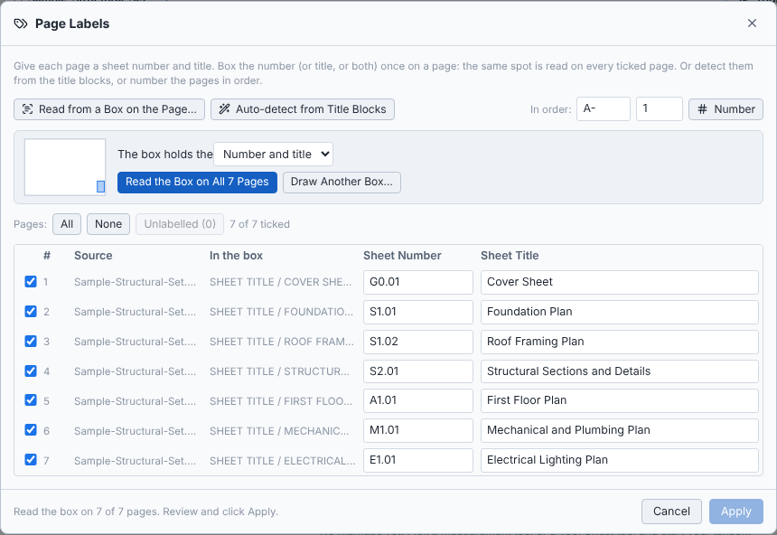

### Flatten markups

*Edit → Flatten Markups…* (also right-click a selection, the drawing or a markup row) draws markups into the PDF
itself – the selected markups, those on this sheet, or all – with or without their measurement labels, optionally
including hidden layers. The drawing then carries them like any other line work (other programs see them, and page
labels and snapping read them). Flattened markups leave the Markups List, or choose **Keep them as takeoff data**: they
stay in the list and totals on a hidden, locked *Flattened* layer so nothing is drawn twice. Undo puts everything back.
*File → Export → Flattened PDF* still makes a marked-up copy without changing the document. Standard detail material
shown on the drawing is drawn with its markups.

### Speed and graphics

* Pages already seen show at once: rendered pages are kept (in graphics memory) and the next and previous sheets are
  rendered ahead while you work, so paging through a set no longer waits for each page. Thumbnails use the same
  renders. Rendering ahead gives way the moment the sheet on screen needs drawing.
* Large sets show the first drawing sooner: page sizes are read in parallel, and on sets over 12 pages the sheet
  numbers are read from the title blocks after the drawing is up.
* PDFs are drawn on graphics-card canvases where the browser allows it.
* *Settings → Speed & Graphics*: in the desktop app, **hardware acceleration** On (default), On even for graphics
  drivers Chromium does not trust, or Off for display problems (restart to apply), with what the graphics card is used
  for; whether to render ahead; how many rendered pages to keep (about 80, 190 or 440 MB); reading labels after
  opening.

### Formula columns

Formulas reference columns by name – `Length` (LF), `Area` (SF), `Volume` (CY), `Count`, `Depth`, `Perimeter`, `Subject`,
or any custom column (`Qty`, `[Member Size]`) – with `+ - * / ^`, comparisons, `&` (text join) and
`IF, ROUND, ROUNDUP, ROUNDDOWN, CEILING, FLOOR, MIN, MAX, ABS, SQRT, AND, OR, NOT, CONCAT`.

Steel helpers: `PLF(shape)` returns lb/ft for W, M, S, HP, C, MC, WT shapes (from the designation), HSS (rectangular and
round), angles, flat bar, rod, pipe and common K-series joists; `PSF(plate)` returns lb/ft² for plate (`PL1/2`,
`1/2" Plate`). The default Weight column is

```
Qty * (Length * PLF([Member Size]) + Area * PSF([Member Size]))
```

Report units (LF/in/m, SF/SY/m², CY/CF/m³) and decimals are set in the **Measurements** panel.

### Keyboard

| Keys | Action |
| --- | --- |
| `V` / hold `Space` / middle-drag | Select / pan |
| Wheel, `Ctrl+0`, `Ctrl+9`, `Ctrl+=`/`-`, `Z` | Zoom at cursor, fit page, fit width, zoom in/out, zoom rectangle |
| `PgUp` / `PgDn` | Previous / next sheet |
| `Ctrl+Tab` / `Ctrl+Shift+Tab`, `Ctrl+F4` | Next / previous document tab, close tab |
| `Ctrl+O`, `Ctrl+S`, `Ctrl+Shift+S` | Open PDF, save (into the PDF), save as |
| `Shift+Alt+K L M A P V C G` | Calibrate, Length, Polylength, Area, Perimeter, Volume, Count, Angle |
| `T Q C R E L A N G P H` | Text, Callout, Cloud, Rectangle, Ellipse, Line, Arrow, Polyline, Polygon, Pen, Highlight |
| `Enter` / double-click / right-click | Finish a multi-point markup; `Backspace` removes the last point; `Esc` cancels |
| `Ctrl+Z` `Ctrl+Y` `Ctrl+C` `Ctrl+V` `Ctrl+D` `Del` | Undo, redo, copy, paste, duplicate, delete |
| Arrow keys (`Shift` ×10) | Nudge selection (pixels or a drawing length – *Settings → Drawing & Editing*) |
| `Ctrl+,` | Settings & Preferences |

These are the defaults: every command's keys can be changed in *Settings → Keyboard*.

Status-bar toggles: **CONTENT** (snap to PDF geometry), **MARKUP** (snap to markup vertices), **ORTHO**, **REUSE** (keep the
tool active), **LABELS** (measurement labels on the drawing).

## Data & persistence

* Everything runs locally on your computer (or in the browser for the web version); nothing is uploaded.
* Each document's takeoff is saved inside its PDF (*File → Save*). Open documents also autosave to IndexedDB (with
  any unsaved changes) and come back on reload.
* Takeoff project files from earlier versions (`.takeoff.json`) still open – *Open Takeoff Project…* on the start
  screen, *File → Open PDF…* or drag them onto the window – as one document per PDF.
* The Tool Chest (including size-tool sizes and hidden tools), list layout, workspace layout, keyboard shortcuts and
  preferences (including the default Markups List layout) are stored per user and shared by all documents.

## Development

```bash
npm run dev        # Vite dev server
npm run build      # type-check + production build to dist/
npm test           # unit tests (units, parsing, scales, geometry, formulas, steel weights, rows, automatic takeoff, line styles, shortcuts, page labels, flattening, takeoff saved in the PDF, list styles, subjects, combine, detail material on the drawing and its presets, dock sections, maximum lengths)
npm run test:e2e   # Playwright end-to-end tests against the sample drawing set
npm run sample     # regenerate the sample set and the S1.02 Addendum 2 revision PDF in public/samples/
npm run example    # regenerate the example takeoff (sample set + addendum; needs `npm run dev` running)
npm run build:artifact  # self-contained bundle in dist-artifact/ for publishing as a claude.ai Artifact
npm run desktop    # build, then run the desktop app with Electron
npm run dist:win   # Windows installer in release/ (see below)
npm run icons      # regenerate app/installer icons from branding/ (or --source <png>, see below)
npm run legal      # regenerate build/license.txt and THIRD-PARTY-NOTICES.txt from legal/
```

The artifact build opens straight into the example takeoff, follows the viewer's light/dark theme, and saves
files (PDF, CSV, styles) through the viewer's download prompt, since a published page cannot start downloads itself.

Stack: React 18, TypeScript, Vite, Zustand, pdf.js (rendering, text and vector extraction), pdf-lib (export), lucide icons.

```
src/
  brand.ts         product name, icon and the desktop bridge
  core/            framework-free logic
    units.ts         ft-in / metric formatting & parsing, scale presets, calibration
    geometry.ts      lengths, areas, centroids, hit-testing helpers, clouds
    measure.ts       per-markup scale resolution (sheet vs viewport) and measurements
    formula.ts       safe expression parser/evaluator for formula columns
    steelShapes.ts   PLF/PSF weight lookup
    columns.ts       built-in + custom column model, row building for the list
    summary.ts       takeoff summary aggregation
    details.ts       standard details: matching rules, by-hand assignments and the material rows they add
    autoTakeoff.ts   automatic takeoff: line work and labels from the PDF, label-to-member matching, printed scales
    autoStyles.ts    automatic takeoff line styles: rules by subject, Tool Chest look, colour per size
    align.ts         overlay maths: similarity fits, text/RANSAC and image alignment, change finding
    compare.ts       overlay rendering helpers: tint matrices, auto-align and changes on rendered sheets
    pdf.ts           pdf.js loading, rendering, title-block text, snap index, line work for automatic takeoff
    renderCache.ts   kept page renders, rendering ahead, background renders that give way to the screen
    keymap.ts        commands and their default keys, key chords, custom bindings and clashes
    text.ts          title-block text: sheet numbers, captions, labels from a box
    export.ts        CSV, printable report, flattened PDF (also used to flatten markups into a document)
    embed.ts         the takeoff saved inside its PDF (an embedded file), and read back
    listStyle.ts     Markups List styles: the file format, built-in style
    subjects.ts      subjects as shapes: the default list, the shape of a size, older subjects
    combine.ts       combine report: pieces by size, nesting them on the stock lengths to order
    combineReport.ts combine report output: order text, CSV, printable page
    detailMarks.ts   standard detail material on the drawing: offset lines, marks along a member, count marks by labels
    maxLength.ts     maximum lengths by shape: cutting a measurement into pieces along its line
  store/           Zustand store (open documents, each with its undo history; panes and tabs), dockLayout.ts
                   (docks split into sections), project.ts
                   (opening, saving into the PDF, closing, autosave), commands
                   (menu and keyboard commands), flatten (markups into new versions of the PDFs)
  components/      viewer (canvas + SVG markup layer), panels, markups list, summary, dialogs,
                   dock/ (dockable/floating panels; Panes.tsx: split panes and detached pane windows)
electron/          Windows desktop shell (main process + preload)
legal/             Terms of Service (source for the app and the installer)
branding/          BuildSuite Takeoff icon artwork
```

Rendering uses a resolution-capped base canvas plus a high-resolution "detail" canvas for the visible region, so large
sheets stay sharp at high zoom. Markups are SVG in PDF point space, so the drawing and the data are two views of one
model: every list cell is computed from the same markup objects that are drawn.

### Issuing license keys

License keys are ECDSA P-256 signatures over the license details (tier, licensed to, company, e-mail, issue date,
expiry), made with a private signing key and checked by the program with the public key in
`src/core/licenseKeys.ts`. The private key is never in the repository.

* **From GitHub** (no tools needed): add the signing key as the repository secret **`LICENSE_PRIVATE_KEY`** (*Settings →
  Secrets and variables → Actions → New repository secret*, the whole contents of `private-key.jwk.json`). Then
  *Actions → Issue license → Run workflow*: choose the tier and fill in who it's for (and an expiry date if any). The
  run's summary shows the key, and the `.bslicense` file is attached to the run.
* **On a computer** with Node: `npm run license -- issue --tier pro --name "Jane Smith" --company "Smith Steel"
  [--email …] [--expires 2027-12-31] [--file jane.bslicense]` with the key in `license/private-key.jwk.json` (or
  `--key <file>`, or the `LICENSE_PRIVATE_KEY` variable). `npm run license -- verify <key>` checks one.
* **A new signing key**: `npm run license -- keygen` writes a new pair to `license/` (ignored by git); put its public key in
  `src/core/licenseKeys.ts` (keep the old one listed for as long as keys signed with it should keep working) and
  update the secret.

Development builds also trust a test key (`e2e/fixtures/license-test`) so the browser tests can run with Pro; released
builds don't.

### Building the Windows installer

`npm run dist:win` builds the web bundle, generates the installer's legal files and runs electron-builder
([electron-builder.yml](electron-builder.yml)) to produce `release/BuildSuite-Takeoff-Studio-Setup-<version>.exe`
(NSIS, x64). On Windows nothing else is needed; on Linux/macOS install Wine (`wine32` and `wine64`) first. The
[Windows installer workflow](.github/workflows/windows-installer.yml) builds it on `windows-latest`, runs the unit tests
and a desktop smoke test (`scripts/desktop-smoke.mjs`), uploads the installer as an artifact, and attaches it to a
GitHub release when a `v*` tag is pushed.

* **Desktop shell** – [electron/main.cjs](electron/main.cjs) serves `dist/` from a private `app://` origin with a strict
  Content-Security-Policy, keeps Node.js out of the renderer (context isolation + sandbox), and exposes a small
  `window.buildsuite` API from [electron/preload.cjs](electron/preload.cjs) for native Save dialogs, report windows and
  files opened from Explorer. F12 opens developer tools.
* **Terms of Service** – [legal/terms-of-service.md](legal/terms-of-service.md) is the single source for the installer's
  license page, `TERMS-OF-SERVICE.txt` in the install folder and *Help → Terms of Service*. Fill in the bracketed
  placeholders (legal entity, address, governing law, privacy policy URL) and have counsel review it before release.
  Open-source licenses of the bundled code go to `THIRD-PARTY-NOTICES.txt`.
* **Branding** – the BuildSuite Takeoff icon is [branding/takeoff-icon.svg](branding/takeoff-icon.svg) (with a
  simplified small-size variant). `npm run icons` renders it to `build/icon.ico` (16–256 px), `build/icon.png`, the
  installer sidebar and `public/brand/`. To use artwork from the BuildSuite icon sheet instead, run
  `node scripts/build-icons.mjs --source <sheet.png> [--crop x,y,size]`.
* **Code signing** – set `CSC_LINK`/`CSC_KEY_PASSWORD` (or `WIN_CSC_LINK`) for electron-builder to sign the app and
  installer; bump `version` in package.json for each release.

### Known limitations

* Scanned (raster) PDFs have no text layer: title-block reading and content snapping need vector PDFs; enter labels by
  hand and rely on markup snapping for scans.
* The takeoff is saved inside the PDF as data this program reads, not as native PDF annotations: other PDF viewers
  show the drawing without the markups. Flatten them into the drawing, or use the flattened PDF export, to share
  marked-up drawings.
* In a browser, `Ctrl+Tab`, `Ctrl+F4` and some other keys belong to the browser; use `Ctrl+Shift+]` / `[` or set your
  own keys. The desktop app gets them all.
* Automatic takeoff needs vector PDFs whose member labels are text placed beside the member, parallel to it. Labels
  connected by a leader line, or one *TYP.* label meant for several members, give one member each; scans have no line
  work or text to read.
* Single user; there is no real-time collaboration.
